<p align="center">
  
</p>

<h1 align="center">more-bananas 🍌</h1>
<p align="center"><em>Is your Mac too small for your work? Measure it, minute by minute, then buy the right amount of RAM.</em></p>

<p align="center">
  <a href="LICENSE"></a>
  <a href="https://github.com/wan-huiyan/more-bananas/commits"></a>
  
  
  <a href="https://claude.com/claude-code"></a>
</p>

> **A tiny background job records what your Mac is really holding every minute (every app, every Claude Code session, and the hidden browsers and scripts those sessions start) and turns it into a cute, self-updating page that tells you how much memory your next laptop needs.**

<p align="center">
  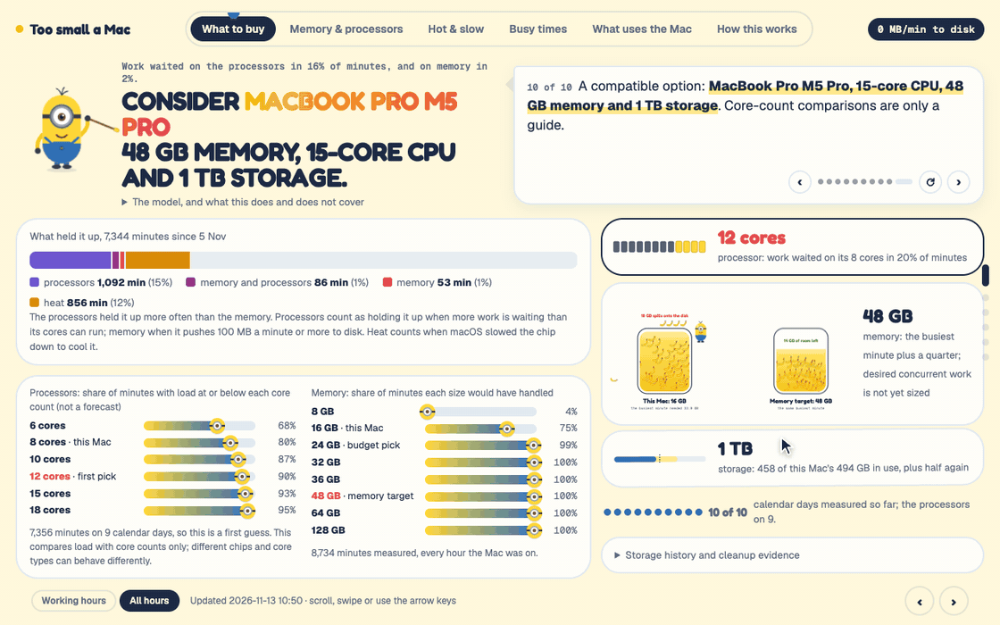
  <br/><sub>Four of the seven tabs: the recommendation, today minute by minute, what uses memory, and what Claude ran in the last 24 hours. The first tab is the answer: on this 16 GB work laptop, 16 GB was enough in only 35% of working minutes, 32 GB would have covered 99%, and 48 GB covers the busiest minute (33.9 GB) with a quarter to spare. Real readings, project names replaced.</sub>
</p>

## Why it exists

"Get more RAM" is usually a guess: someone counts browser tabs, or the number of AI coding sessions they *think* they run, and picks a size. Then the laptop stalls on the one afternoon it matters, mid client call.

This measures instead. It reads macOS's own memory figures once a minute, keeps them on your Mac, and answers three questions on one page: **how much memory does my work actually need, when does it run out, and what is using it?** If you run Claude Code, it also shows the cost you can't see: each session can start Playwright test browsers, plug-in servers and scripts, and those add up.

## What you get

| | Feature | The specifics |
|---|---|---|
| 🎯 | **A measured recommendation, explained** | Busiest minute ever recorded × 1.25, rounded up to a size Macs are sold in, and the buddy walks you through how it got there, step by step. Plus a budget pick (smallest size that covered 99% of working minutes) and storage (current use × 1.5). Updates itself every minute. |
| 📊 | **"Would it have fitted?" ladder** | For 16 / 24 / 32 / 36 / 48 / 64 GB: the share of your working minutes (7am to midnight) each size would have handled, with and without Claude's hidden test browsers. |
| 📈 | **Today, minute by minute** | Memory needed against your RAM line, the striped overflow onto disk, and the minutes the Mac was actively moving memory to disk. Hover any minute. |
| 📅 | **Busy days and busy hours** | One timeline since the history start: Claude Code sessions open at once above the line, memory over your RAM below it. Plus a weekday × hour heatmap. |
| 🧸 | **Who is using it** | One walking banana buddy per app and per Claude Code session, sized by memory. Every app's memory now / 24 h / 7 days / 30 days. |
| 🤖 | **What Claude runs** | Claude's tools grouped into plain kinds (test browsers, page checks, cloud tools, plug-ins, build scripts, shell), each opening into its scripts and the session folder that started them. |
| 🪶 | **Light** | One run takes about 0.35 s a minute and stores about 1 MB of readings a day. Nothing is sent anywhere. |
| 🛟 | **Survives a dead laptop** | Optional copy of readings and page to Google Drive every 15 minutes. |

## See it in action

<p align="center">
  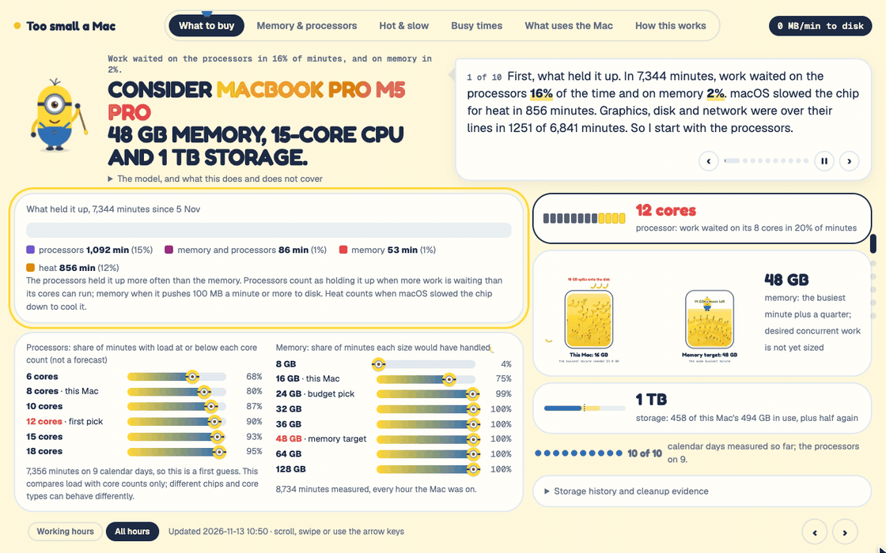
  <br/><sub><b>🧑‍🏫 The buddy shows its working.</b> On the Recommendation tab it explains the answer one step at a time, and the page's own charts act out each step: the bars regrow as it counts the minutes, the part that didn't fit turns into red &ldquo;on the disk&rdquo; stripes, a 99% line drops for the budget pick, and the jar comes forward to be measured (busiest minute, plus a quarter, rounded up to a size Macs come in). Storage and days measured get their own little gauges. Every number comes from your own readings, and steps that don't apply to your Mac are left out. Pause, step back, or replay any time.</sub>
</p>

<table>
<tr>
<td width="50%" valign="top">
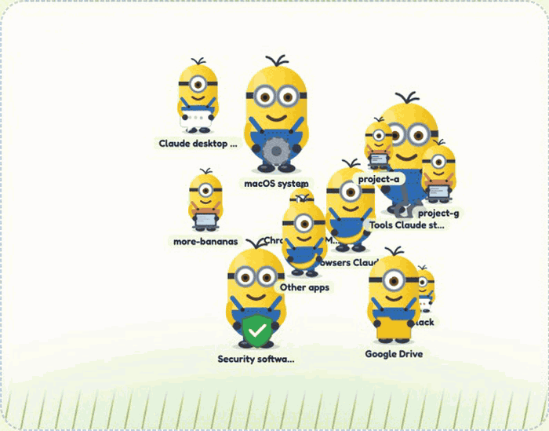
<br/><b>🧸 Who is in your RAM right now.</b> One buddy per app and per Claude Code session, refreshed every minute. Bigger buddy, more memory; two goggles means over 1 GB. Click one to ask what it is.
</td>
<td width="50%" valign="top">
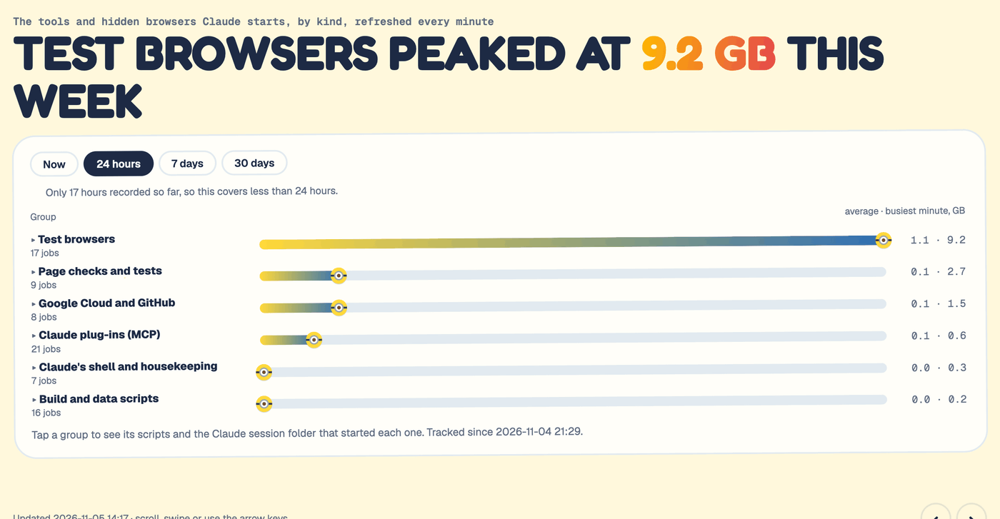
<br/><b>🤖 What Claude runs.</b> Switch between now, 24 hours, 7 days and 30 days. Here the hidden test browsers peaked at 9.2 GB; open a group to see each script and the project that started it.
</td>
</tr>
<tr>
<td width="50%" valign="top">
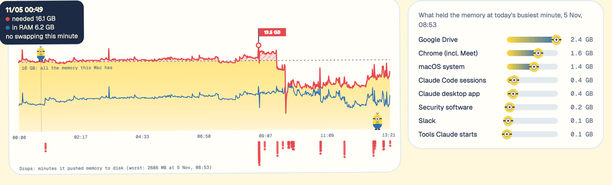
<br/><b>📈 Every minute of today.</b> Hover anywhere to read that minute: memory needed, memory in RAM, and whether the Mac was swapping. This day needed 19.5 GB on a 16 GB Mac, with 23 minutes of swapping.
</td>
<td width="50%" valign="top" align="center">
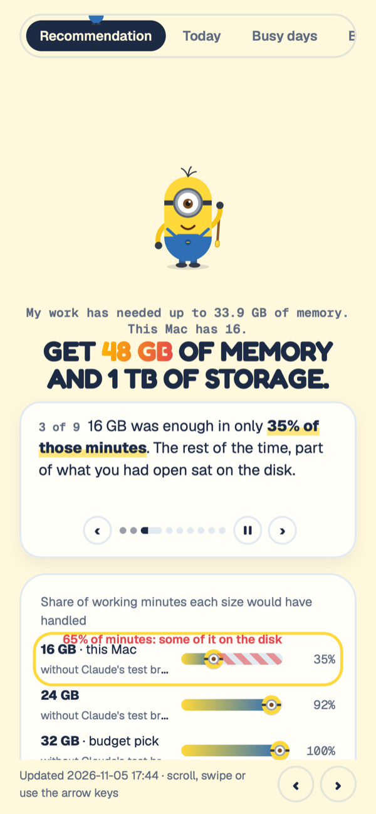
<br/><b>📱 Works on a phone too.</b> Open the page from Google Drive (with <code>--drive-backup</code>) and swipe through the tabs.
</td>
</tr>
</table>

### 📸 Every tab, and what it tells you

| | |
|---|---|
| 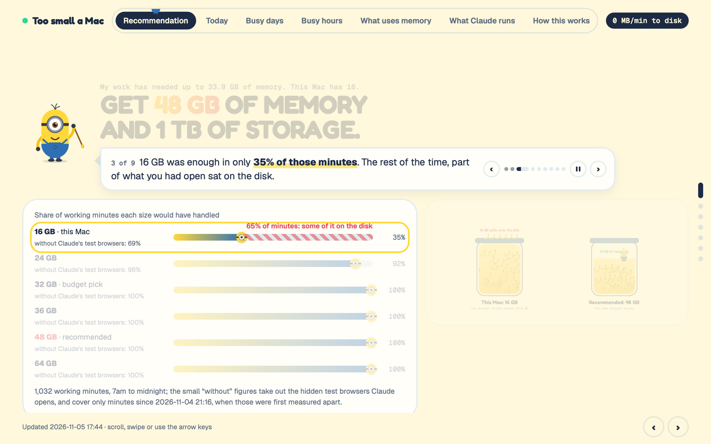<br/>**🎯 Recommendation.** The RAM and storage to buy, how often each size would have been enough, and the buddy's step-by-step reasoning. | 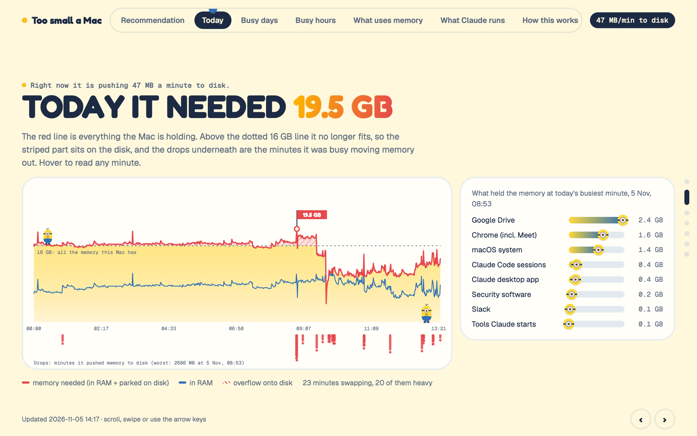<br/>**📈 Today.** Today minute by minute against your RAM line, and which apps held the busiest minute. |
| 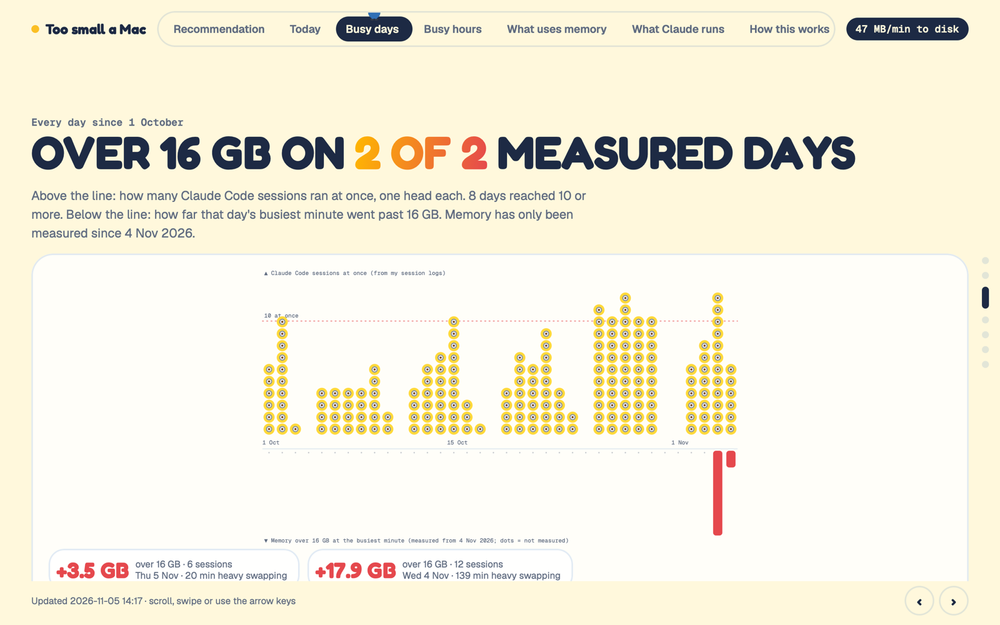<br/>**📅 Busy days.** Claude Code sessions open at once (top) and memory over your RAM (bottom), day by day on one timeline. | 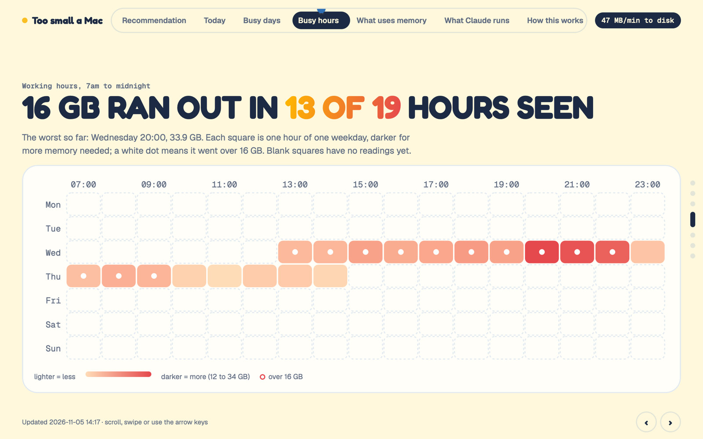<br/>**🕐 Busy hours.** Weekday × hour heatmap, 7am to midnight: which hours run out. Here, 13 of the 19 hours seen. |
| 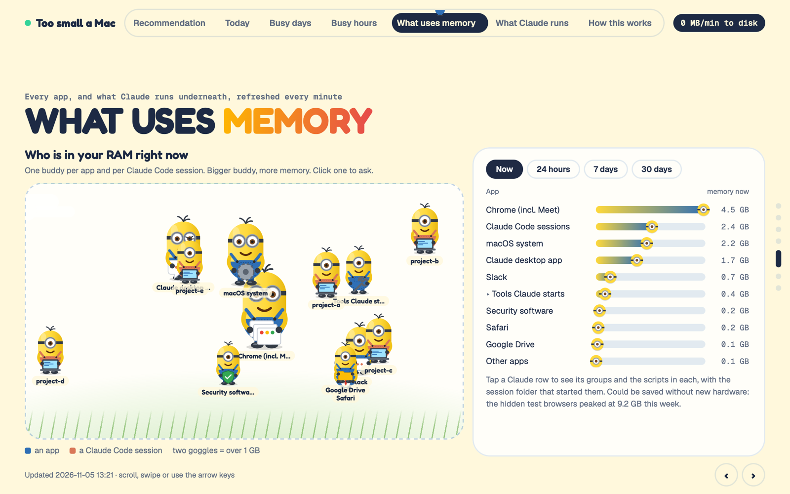<br/>**🧸 What uses memory.** The buddy yard, plus every app's memory now, over 24 hours, 7 days and 30 days. | 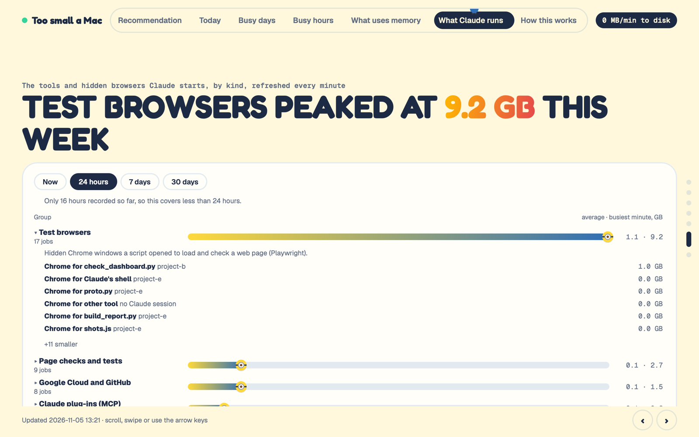<br/>**🤖 What Claude runs.** Claude's tools in plain groups: test browsers, page checks, cloud tools, plug-ins, build scripts, shell. |
| 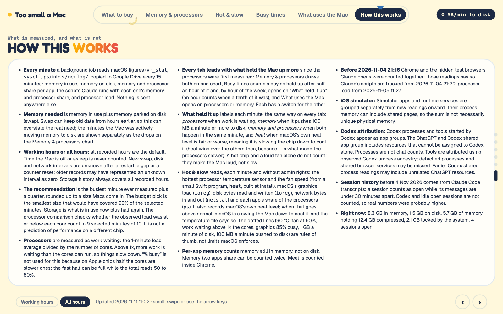<br/>**🔍 How this works.** What each number means, where it comes from, and what it can't tell you. | |

## Quick start

**Without Claude Code** (any Mac with Python 3, which comes with the Xcode command line tools):

```bash
git clone https://github.com/wan-huiyan/more-bananas
cd more-bananas/skills/more-bananas
./install.sh --dock
```

The page opens in your browser and a **Memory Monitor** buddy appears in your Dock. That's it: leave it running through a normal busy week.

**With Claude Code**, install it as a plugin and ask Claude to set it up:

```bash
claude plugin marketplace add wan-huiyan/more-bananas
claude plugin install more-bananas@wan-huiyan-more-bananas
```

Then say: *"install more-bananas"*. Claude runs the installer with the Dock buddy and opens the page.

<details>
<summary>Options and removal</summary>

```bash
./install.sh --dock                       # add a Memory Monitor app to the Dock
./install.sh --drive-backup               # copy readings to My Drive/Memory Monitor every 15 min
./install.sh --history-from 2026-10-01    # ignore Claude Code session history before a date
./uninstall.sh                            # stop it, keep the readings in ~/memlog
./uninstall.sh --purge                    # stop it and delete the readings
```

Re-running `install.sh` upgrades the code and keeps your readings and settings. Settings live in `~/memlog/config.json`.

</details>

## Where it lives on your Mac

<p align="center">
  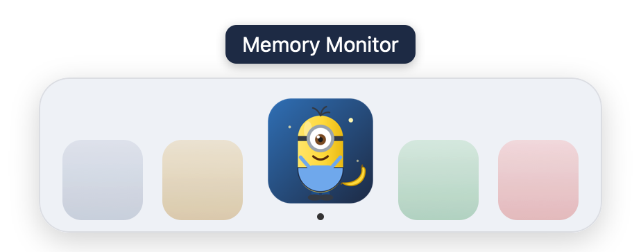
  <br/><sub>Your entry point: click the buddy in the Dock and the page opens in your browser.</sub>
</p>

| What | Where |
|---|---|
| 🧸 **Dock buddy** (with `--dock`) | `~/Applications/Memory Monitor.app`, pinned to your Dock. Your Dock layout is saved to `~/memlog/dock-backup.plist` first. |
| 📄 **The page** | `~/memlog/memory-report.html`, with a shortcut on your Desktop: `~/Desktop/memory-report.html`. Opens in any browser, works offline, and the tab shows the buddy too. |
| 📊 **Your readings** | `~/memlog/*.csv`: memory, apps, swapping, Claude's tools, processor. Plain CSV, yours to keep. |
| ⚙️ **Settings** | `~/memlog/config.json` |
| ⏱️ **The background job** | `~/Library/LaunchAgents/com.memlog.monitor.plist`, run by macOS every 60 seconds, including after a restart. Errors go to `~/memlog/error.log`. |
| ☁️ **Backup** (with `--drive-backup`) | `My Drive/Memory Monitor/` in Google Drive, every 15 minutes |

`uninstall.sh` removes the Dock app, the Desktop shortcut and the background job; `--purge` also deletes `~/memlog`.

## Using it

- **Open it:** click the Dock buddy, or open `~/Desktop/memory-report.html`. It refreshes itself every minute.
- **Move around:** the tab bar, the scroll wheel, a swipe, or the arrow keys. One tab per screen, no long scroll.
- **Ask Claude:** *"how much RAM should my next Mac have?"*, *"why is my Mac slow this afternoon?"*, *"what is Claude running that uses so much memory?"* Claude reads the same files in `~/memlog/`.

## Limitations (read these before you buy anything)

- **It needs a busy week.** The answer is only as good as the days recorded; a quiet week understates it. The page shows how many working days it has (goal: 10).
- **It leans high.** "Memory needed" is RAM in use plus swap, and swap can hold stale data from hours earlier. The minutes the Mac was *actively* writing to disk are shown separately as the fairer slowdown signal.
- **Per-app figures are approximate.** They count memory still in RAM (not on disk), memory two apps share can be counted twice, and Meet or Zoom in a browser count as the browser.
- **History before install is partial.** Days before the monitor started come from Claude Code transcripts only; Codex and sessions idle for 30+ minutes are not counted.
- **Processor load is recorded but light-touch:** share of all cores busy per minute. It tells you whether memory or the chip is the limit, not which chip to buy.
- **macOS only.** It reads `vm_stat`, `sysctl` and `ps`, and runs under launchd.

## How it works

`launchd` runs `memlog.py` once a minute. It reads macOS's memory figures, groups processes into apps (and Claude Code's child processes into the session that started them), appends a row to a few CSV files in `~/memlog/`, and rebuilds one self-contained HTML page. No server, no network, no dependencies beyond the Python that ships with the Xcode command line tools.

```
skills/more-bananas/
├── SKILL.md            what Claude reads when you ask it to install or explain the monitor
├── install.sh          sets up ~/memlog, the launchd job, the Desktop link and the Dock app
├── uninstall.sh
└── app/
    ├── memlog.py       takes a reading, writes the CSVs, rebuilds the page
    ├── report.py       the page: tabs, charts, recommendation
    ├── buddy.py        the mascot, the buddy yard, the sparkles
    └── backfill_sessions.py   session history from ~/.claude/projects transcripts
```

## License

MIT. The banana buddy is an original drawing made for this project.
